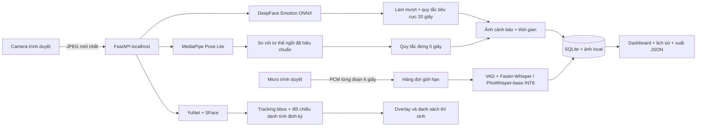

# ExamWatch Local — Kiến trúc đã triển khai

Demo độc lập cho 1–3 người, chạy một process FastAPI trên 127.0.0.1.
Bản tài liệu cũ được giữ trong backups/ARCHITECTURE.original.md.

## Phân chia mã

- config.py: đường dẫn local, ngưỡng và cấu hình CPU.
- vision.py: phát hiện mặt, embedding SFace, tiền xử lý Emotion theo DeepFace,
  Pose Landmarker và ghép khuôn mặt với landmark.
- tracking.py: matching overlap bảo thủ, đối chiếu gallery, chống gán một danh tính
  cho hai người hiện diện cùng lúc. Chưa có re-identification khi che nhau.
- rules.py: bộ đếm monotonic clock, ngắt khi mất dữ liệu; so sánh đầu/vai với baseline.
- speech.py: ASR tiếng Việt từ PCM float32; VAD và ngưỡng im lặng.
- runtime.py: khóa vòng đời phiên và suy luận ảnh; worker âm thanh độc lập, hàng đợi
  sáu đoạn. Job giữ session ID gốc kể cả khi phiên đã kết thúc.
- store.py: SQLite WAL, connection riêng từng thao tác; danh tính, sự kiện,
  transcript và quan sát khoảng một lần mỗi giây/người.
- main.py: API, kiểm tra owner/capture ID để không nhận frame/audio của phiên cũ
  hoặc tab khác; chặn mutation cross-origin.
- web/: thu media theo thao tác người dùng, AudioWorklet, overlay, đăng ký,
  giám sát và lịch sử. Không phụ thuộc CDN.

## Những phần chưa triển khai

Không có cloud sync, outbox, sơ đồ ghế, xác định người nói, nhận biết rời ghế,
Kalman/Hungarian tracker hoặc classifier đứng/nhổm huấn luyện trên dữ liệu phòng thi.
Không có độ chính xác hay FPS được bảo đảm trên mọi thiết bị.

Tư thế là heuristic phần thân trên và cần hiệu chuẩn; cảm xúc là tín hiệu tham khảo.
Quy trình sử dụng và kiểm chứng nằm trong README.md và VERIFICATION.md.
